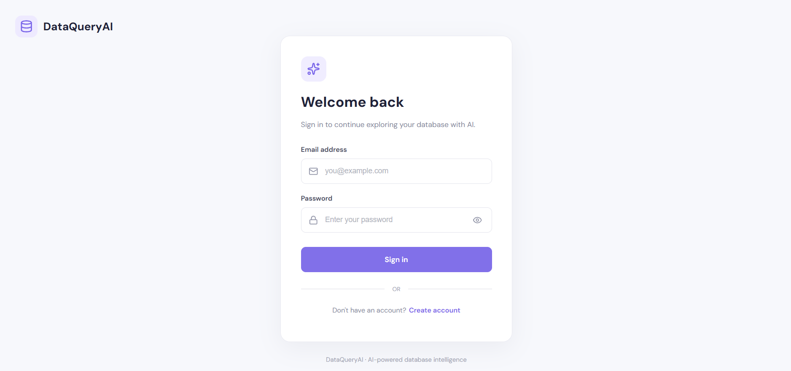
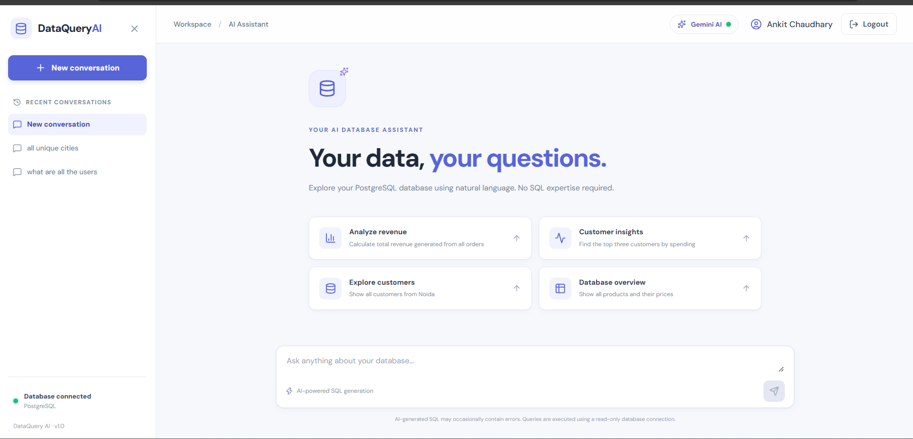
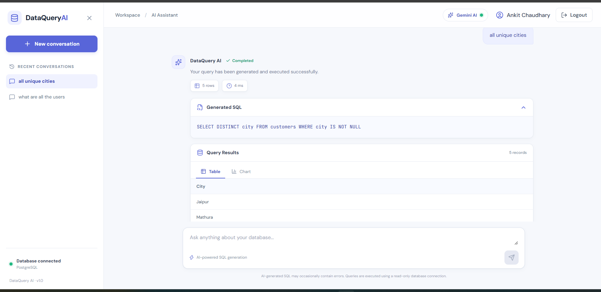

# DataQuery AI

### Query Your Database Using Natural Language

DataQuery AI is an AI-powered database assistant that allows users to interact with PostgreSQL databases using natural language instead of writing SQL queries manually.

Powered by Google's Gemini AI, the application converts questions into SQL queries, validates the generated SQL, executes them against a PostgreSQL database, and presents the results in an interactive interface.

The project combines AI-powered SQL generation, automatic SQL error correction, database querying, and user authentication into a single full-stack application.

---

## Features

### 1. Natural Language to SQL
- Convert everyday English questions into SQL queries.
- Generate context-aware SQL using database schema information.
- Use Google Gemini AI for SQL generation.

### 2. SQL Validation and Automatic Correction
- Validate AI-generated SQL using `node-sql-parser`.
- Allow only SELECT queries.
- Reject multiple SQL statements.
- Automatically attempt to correct SQL queries when execution or syntax errors occur.
- Support up to two automatic correction attempts.

### 3. PostgreSQL Integration
- Connect to PostgreSQL databases.
- Retrieve database schema information.
- Execute validated SQL queries.
- Display query results in structured tables.

### 4. Interactive Data Visualization
- View query results in a tabular format.
- Visualize suitable query results using bar charts.
- Display execution time and returned row counts.

### 5. User Authentication
- User registration and login.
- Password hashing using bcrypt.
- JWT-based authentication.
- HTTP-only authentication cookies.
- Protected application routes and API endpoints.
- User-specific conversation ownership.

### 6. Conversation Management
- Create multiple conversations.
- Maintain conversation context for follow-up questions.
- Retrieve previous messages for context-aware SQL generation.
- Store conversation data in PostgreSQL.
- Maintain local conversation history in the frontend.

---

## Technology Stack

| Category | Technologies |
|---|---|
| Frontend | React.js, JavaScript, HTML, CSS |
| Backend | Node.js, Express.js |
| Database | PostgreSQL |
| AI Integration | Google Gemini API |
| Authentication | JWT, bcrypt, HTTP-only Cookies |
| SQL Parsing | node-sql-parser |
| HTTP Client | Axios |
| Data Visualization | Recharts |
| Icons | Lucide React |
| Development Tools | VS Code, pgAdmin, Git, GitHub |

---

## Application Architecture

The application follows a client-server architecture.

```text
                 USER
                   |
                   |
                   v
          REACT FRONTEND
                   |
                   |
             Axios API
                   |
                   v
          EXPRESS BACKEND
                   |
          +--------+--------+
          |                 |
          v                 v
    AUTHENTICATION      QUERY CONTROLLER
          |                 |
          v                 v
      JWT / bcrypt     DATABASE SCHEMA
                            |
                            v
                       GEMINI AI
                            |
                            v
                     GENERATED SQL
                            |
                            v
                     SQL VALIDATION
                            |
                            v
                   QUERY EXECUTION
                            |
                            v
                       POSTGRESQL
                            |
                            v
                    QUERY RESULTS
                            |
                            v
                     REACT FRONTEND
                            |
                            v
                  TABLES / CHARTS
```

---

## Application Preview

### Login Page


### Dashboard


### Query Results



## SQL Generation Workflow

When a user submits a natural language question, the following process takes place:

1. The frontend sends the question to the Express backend.
2. The backend validates the input and retrieves the conversation context.
3. The database schema is retrieved to provide context to Gemini.
4. Gemini generates an SQL query based on the user's question and database schema.
5. The generated SQL is parsed and validated.
6. Only valid SELECT queries are allowed.
7. The validated query is executed against PostgreSQL using a read-only transaction.
8. If a correctable SQL error occurs, Gemini attempts to generate a corrected query.
9. The query results are returned to the frontend.
10. Results are displayed in tables or charts.

---

## Project Structure

```text
Data_Query_AI/
│
├── client/
│   ├── public/
│   ├── src/
│   │   ├── assets/
│   │   ├── components/
│   │   │   └── ProtectedRoute.jsx
│   │   │
│   │   ├── context/
│   │   │   └── AuthContext.jsx
│   │   │
│   │   ├── pages/
│   │   │   ├── Login.jsx
│   │   │   └── Register.jsx
│   │   │
│   │   ├── services/
│   │   │   └── api.js
│   │   │
│   │   ├── App.jsx
│   │   ├── Dashboard.jsx
│   │   ├── App.css
│   │   ├── Auth.css
│   │   ├── index.css
│   │   └── main.jsx
│   │
│   └── package.json
│
├── server/
│   ├── config/
│   │
│   ├── controllers/
│   │   ├── authController.js
│   │   ├── databaseController.js
│   │   └── queryController.js
│   │
│   ├── middleware/
│   │   └── authMiddleware.js
│   │
│   ├── routes/
│   │   ├── authRoutes.js
│   │   ├── databaseRoutes.js
│   │   └── queryRoutes.js
│   │
│   ├── services/
│   │   ├── aiService.js
│   │   ├── conversationService.js
│   │   ├── queryExecutionService.js
│   │   ├── schemaService.js
│   │   └── sqlValidationService.js
│   │
│   ├── app.js
│   ├── server.js
│   └── package.json
│
├── .gitignore
└── README.md
```

---

## Getting Started

Follow these instructions to run DataQuery AI locally.

### Prerequisites

Make sure you have installed:

- Node.js and npm
- PostgreSQL
- pgAdmin (optional, for database management)
- Google Gemini API key
- Git

### 1. Clone the Repository

```bash
git clone https://github.com/AnkitChaudhary99/DataQuery-AI.git

cd DataQuery-AI
```

### 2. Install Backend Dependencies

```bash
cd server

npm install
```

### 3. Configure Environment Variables

Create a `.env` file inside the `server` directory.

Configure the required environment variables according to your backend configuration.

Example:

```env
PORT=5000
NODE_ENV=development

JWT_SECRET=your_secure_jwt_secret
JWT_EXPIRES_IN=1d

GEMINI_API_KEY=your_gemini_api_key

# PostgreSQL connection settings
DB_HOST=localhost
DB_PORT=5432
DB_NAME=your_database_name
DB_USER=your_database_user
DB_PASSWORD=your_database_password
```

**Note:** The PostgreSQL and Gemini variable names above are examples. Match them to the actual variable names used in your `config/database.js`, `config/readonlyDatabase.js`, and `services/aiService.js` files.

Never commit your actual `.env` file or expose your API keys.

### 4. Configure PostgreSQL

Create a PostgreSQL database and configure the required schemas and tables.

The application uses the `app_internal` schema for internal application data, including:

- Users
- Conversations
- Messages

Configure the database connection settings in your backend environment variables.

Ensure that the database roles and permissions are configured appropriately, including a read-only role for executing generated queries.

### 5. Start the Backend

From the `server` directory:

```bash
npm run dev
```

The backend should start at:

```text
http://localhost:5000
```

### 6. Install Frontend Dependencies

Open another terminal:

```bash
cd client

npm install
```

### 7. Start the Frontend

```bash
npm run dev
```

The frontend will typically be available at:

```text
http://localhost:5173
```

---

## API Endpoints

### Authentication

| Method | Endpoint | Description | Access |
|---|---|---|---|
| POST | `/api/auth/register` | Register a new user | Public |
| POST | `/api/auth/login` | Authenticate a user | Public |
| POST | `/api/auth/logout` | Log out the current user | Protected |
| GET | `/api/auth/me` | Retrieve current user details | Protected |

### Database

| Method | Endpoint | Description | Access |
|---|---|---|---|
| GET | `/api/database/schema` | Retrieve database schema | Protected |

### AI Query

| Method | Endpoint | Description | Access |
|---|---|---|---|
| POST | `/api/query/generate` | Generate and execute SQL | Protected |

Example request:

```json
{
  "question": "Show the top 5 customers by total spending"
}
```

---

## Security Considerations

DataQuery AI incorporates multiple security mechanisms:

- Password hashing using bcrypt.
- JWT-based authentication.
- HTTP-only cookies for authentication tokens.
- Protected API routes using authentication middleware.
- SQL parsing and validation before execution.
- Restriction to SELECT statements.
- Read-only PostgreSQL transactions.
- Query execution timeout.
- Parameterized SQL queries for internal database operations.
- User ownership checks for conversations.

These mechanisms provide multiple layers of protection when interacting with the database.

---

## Future Improvements

Potential future enhancements include:

- Persistent conversation history synchronized across devices.
- Conversation history management through the backend API.
- Support for multiple database connections.
- More advanced data visualizations.
- CSV and Excel export functionality.
- Query execution analytics.
- Improved query optimization and performance monitoring.
- Cloud deployment.

---

## Contributing

Contributions, suggestions, and feature requests are welcome.

If you find a bug or have an idea for improvement, feel free to open an issue or submit a pull request.

---

## Author

**Ankit Chaudhary**

GitHub: https://github.com/AnkitChaudhary99

---

## License

This project is available for educational and portfolio purposes.